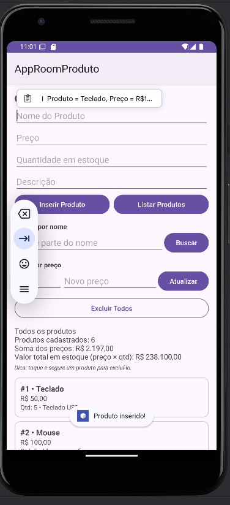
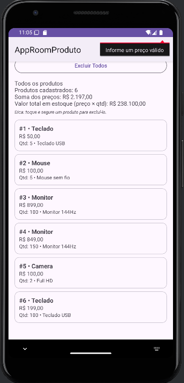
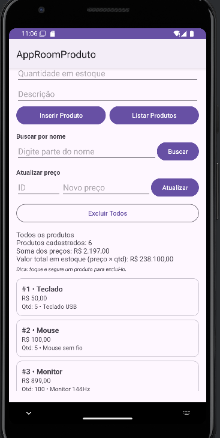
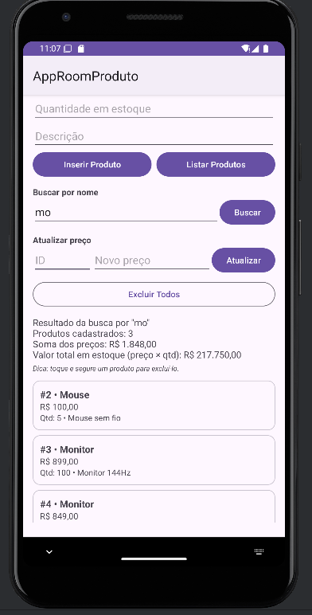
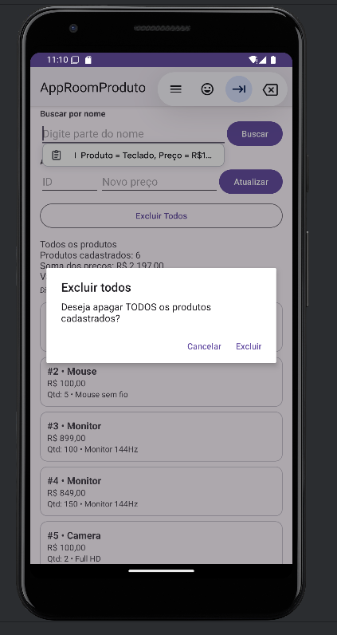
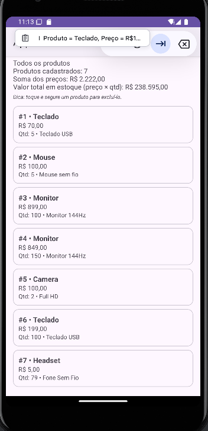

# AppRoomProduto: Cadastro de Produtos com Room SQLite

**Aluno:**
- Lucas Ribeiro, RA 247165

**Disciplina:** Desenvolvimento de Dispositivos Móveis  
**Professor(a):** ALESSANDRO FERREIRA

## Sobre o projeto

Aplicação Android desenvolvida em Kotlin para realizar o gerenciamento completo (cadastro, listagem, pesquisa, atualização e remoção) de produtos utilizando armazenamento local via Room (SQLite). Além de seguir o roteiro base, todas as etapas da Parte A foram concluídas — englobando também os desafios adicionais (uso de `RecyclerView` e remoção individual via `@Delete`) — e a instância do banco de dados foi estruturada seguindo o padrão Singleton.

## Tecnologias

- Kotlin
- Room 2.6.1 (SQLite)
- ViewBinding
- Corrotinas (lifecycleScope)
- RecyclerView + ListAdapter/DiffUtil
- Material Components

## Estrutura

```
app/src/main/java/br/unimes/approomproduto/
├── model/Product.kt          ← entidade (tabela product)
├── dao/ProductDao.kt         ← comandos do banco
├── db/AppDatabase.kt         ← banco de dados (Singleton)
└── view/
    ├── MainActivity.kt       ← tela e regras
    └── ProductAdapter.kt     ← adapter do RecyclerView
```

## Prints do app


## Parte A: Complemento prático

### A1. Limpar campos após inserir

**O que foi feito:** assim que o registro do produto é concluído no banco, o método `limparCampos()` esvazia os inputs de texto (Nome, Preço, Quantidade e Descrição) e reposiciona o foco de digitação no campo Nome utilizando `requestFocus()`. A chamada desse método ocorre dentro do bloco da corrotina, imediatamente após a execução do `insertAll`, assegurando que a limpeza da interface só aconteça depois que a gravação for finalizada.

```kotlin
private fun limparCampos() {
    binding.editProductName.text.clear()
    binding.editProductPrice.text.clear()
    binding.editProductQuantity.text.clear()
    binding.editProductDescription.text.clear()
    binding.editProductName.requestFocus()
}
```

Print: 

### A2. Validação de preço

**O que foi feito:** o valor digitado para o preço passa por uma conversão usando `toDoubleOrNull()` (tratando tanto vírgula quanto ponto decimal). Caso o resultado seja nulo (campo em branco ou texto inválido), igual a zero ou negativo, a gravação é interrompida e um aviso de erro é exibido diretamente no input. O campo de nome passa por uma checagem equivalente.

```kotlin
val price = binding.editProductPrice.text.toString().replace(',', '.').toDoubleOrNull()

if (price == null || price <= 0.0) {
    binding.editProductPrice.error = "Informe um preço válido"
    binding.editProductPrice.requestFocus()
    return
}
```

Print: 

### A3. Lista na tela (desafio extra: RecyclerView)

**O que foi feito:** para não restringir a visualização dos itens apenas ao Logcat, a listagem passou a ser renderizada diretamente na interface através de um `RecyclerView` (desafio extra). Cada item é exibido em um card próprio contendo ID, nome, preço formatado em moeda local (R$), quantidade e descrição. A implementação do adapter recorre ao `ListAdapter` combinado ao `DiffUtil`, otimizando a reciclagem para atualizar somente os elementos que sofreram alteração. Acima da listagem, foi posicionado um `TextView` (`txtResumo`) para apresentar os dados consolidados, mantendo-se também o registro em paralelo no Logcat.

```kotlin
adapter = ProductAdapter { product -> confirmarExclusao(product) }
binding.recyclerProdutos.layoutManager = LinearLayoutManager(this)
binding.recyclerProdutos.adapter = adapter

private fun listarProdutos() {
    lifecycleScope.launch {
        val products = productDao.getAll()
        mostrarProdutos(products, "Todos os produtos")
    }
}
```

Print: 

### A4. Total do estoque

**O que foi feito:** acompanhando a listagem na interface, o componente `txtResumo` apresenta o total de itens registrados (`products.size`) e o somatório dos preços unitários (`products.sumOf { it.price }`). Aproveitando a inclusão do atributo de quantidade em estoque solicitada no item A8, adicionou-se também o cálculo do valor financeiro total do estoque (multiplicando preço por quantidade).

```kotlin
val quantidadeProdutos = products.size
val somaPrecos = products.sumOf { it.price }
val valorEstoque = products.sumOf { it.price * it.quantity }

binding.txtResumo.text = buildString {
    appendLine(titulo)
    appendLine("Produtos cadastrados: $quantidadeProdutos")
    appendLine("Soma dos preços: ${moeda.format(somaPrecos)}")
    append("Valor total em estoque (preço × qtd): ${moeda.format(valorEstoque)}")
}
```

Print: 

### A5. Buscar por nome

**O que foi feito:** adicionou-se ao DAO o método `buscarPorNome` utilizando o operador SQL `LIKE`, juntamente com um campo de pesquisa e o botão **Buscar** na tela. O termo informado pelo usuário é concatenado com curingas `%` (`"%$texto%"`), permitindo buscas parciais (por exemplo, pesquisar por "tec" retorna "Teclado"). Caso a busca seja acionada com o campo em branco, o aplicativo recarrega a listagem completa de produtos.

```kotlin
// ProductDao.kt
@Query("SELECT * FROM product WHERE name LIKE :nome")
suspend fun buscarPorNome(nome: String): List<Product>

// MainActivity.kt
lifecycleScope.launch {
    val encontrados = productDao.buscarPorNome("%$texto%")
    mostrarProdutos(encontrados, "Resultado da busca por \"$texto\"")
}
```

Print: 

### A6. Excluir produtos (desafio extra: excluir pelo id com @Delete)

**O que foi feito:** a opção **Excluir Todos** aciona o método `deleteAll()` somente após o usuário confirmar a ação em um `AlertDialog`, prevenindo remoções por engano. Já para o desafio extra, implementou-se o clique longo sobre qualquer card da lista: o aplicativo exibe um diálogo de confirmação para aquele item específico e invoca `delete(product)`, que utiliza a anotação `@Delete`. Internamente, o Room identifica qual registro remover baseando-se na chave primária (`id`) da instância fornecida.

```kotlin
// ProductDao.kt
@Query("DELETE FROM product")
suspend fun deleteAll()

@Delete
suspend fun delete(product: Product)

// MainActivity.kt (toque longo em um item)
lifecycleScope.launch {
    productDao.delete(product)
    listarProdutos()
}
```

Excluir um produto específico (toque longo no item):


Excluir todos os produtos:



### A7. Atualizar produto

**O que foi feito:** o usuário preenche o **ID** desejado e o **novo preço**, acionando em seguida o botão **Atualizar**. O sistema localiza o registro correspondente através de `getById`, gera uma nova instância alterando apenas o preço por meio da função `copy()` (visto que as propriedades da `data class` são imutáveis) e persiste a modificação via `@Update`. Caso o ID informado não conste no banco, o campo exibe a mensagem de erro "Produto não encontrado".

```kotlin
// ProductDao.kt
@Query("SELECT * FROM product WHERE id = :id")
suspend fun getById(id: Int): Product?

@Update
suspend fun update(product: Product)

// MainActivity.kt
lifecycleScope.launch {
    val produto = productDao.getById(id)
    if (produto == null) {
        binding.editUpdateId.error = "Produto não encontrado"
        return@launch
    }
    productDao.update(produto.copy(price = novoPreco))
    listarProdutos()
}
```

Print: 

### A8. Novo campo na tabela (quantity)

**O que foi feito:** foi incluída na classe de entidade `Product` a propriedade `quantity: Int` (representando o saldo em estoque), adicionou-se o respectivo campo "Quantidade em estoque" no arquivo de layout e incrementou-se o parâmetro `version` da anotação `@Database` de **1 para 2**.

```kotlin
// Product.kt
@ColumnInfo(name = "quantity") val quantity: Int = 0

// AppDatabase.kt
@Database(entities = [Product::class], version = 2)
```

**O que aconteceu com os produtos já cadastrados e por quê:** ao executar a aplicação após essa modificação, **todos os itens que haviam sido salvos anteriormente desapareceram**. Esse comportamento ocorre porque o Room identifica que houve uma alteração estrutural na tabela (adição de uma coluna) acompanhada do avanço da versão do banco de 1 para 2. Como nenhuma regra de `Migration` foi fornecida para instruir a transição da estrutura antiga para a nova, o método `fallbackToDestructiveMigration()` é acionado: ele descarta a base de dados anterior e constrói uma nova totalmente limpa, já contemplando a coluna `quantity`. Caso o número da versão não tivesse sido incrementado, o aplicativo sofreria um crash na inicialização, pois o Room apontaria divergência entre o schema atual e o registrado no dispositivo. Para preservar os registros existentes, seria necessário implementar um objeto de migração, como no exemplo abaixo:

```kotlin
val MIGRATION_1_2 = object : Migration(1, 2) {
    override fun migrate(db: SupportSQLiteDatabase) {
        db.execSQL("ALTER TABLE product ADD COLUMN quantity INTEGER NOT NULL DEFAULT 0")
    }
}
// .addMigrations(MIGRATION_1_2) no databaseBuilder
```

Print: 

## Parte B: Questões dissertativas

### B1. O que é persistência de dados? O que aconteceria se os produtos fossem guardados apenas em uma MutableList?

**Resposta:** Persistência de dados refere-se à capacidade de armazenar informações de maneira durável, garantindo que elas não se percam quando o aplicativo é encerrado, o smartphone é reiniciado ou o sistema operacional finaliza o processo em segundo plano. Neste projeto, os itens cadastrados ficam salvos em um arquivo físico do SQLite (`database-name`) dentro do armazenamento interno do dispositivo; dessa forma, mesmo fechando e abrindo o app novamente, basta acionar a listagem para recuperar todos os registros. Se esses produtos fossem mantidos somente em uma `MutableList` instanciada na `MainActivity`, os dados ficariam alocados exclusivamente na memória volátil (RAM), atrelados ao tempo de vida daquela tela. Qualquer fechamento do app, limpeza de memória pelo Android ou simples rotação do aparelho (que destrói e recria a Activity) apagaria toda a lista. Em resumo, uma lista em memória atua como uma anotação provisória, ao passo que o Room opera como um arquivo definitivo em disco.

### B2. Qual é a diferença entre usar o SQLite diretamente e usar o Room? Cite pelo menos duas vantagens do Room.

**Resposta:** Ao trabalhar com a API pura do SQLite (via `SQLiteOpenHelper`), é necessário redigir manualmente os scripts de criação de tabelas (`CREATE TABLE`), montar querys de inserção e busca, gerenciar a abertura e o fechamento de conexões e iterar sobre objetos `Cursor` extraindo coluna por coluna para instanciar as classes de modelo. Isso gera bastante código boilerplate e aumenta a chance de erros de digitação. O Room atua como uma camada de abstração em cima do SQLite: definimos a estrutura da tabela através de uma `data class` (`Product`) e declaramos as ações na interface `ProductDao` usando anotações, deixando para o Room a tarefa de gerar a implementação real em tempo de compilação (via `kapt`). Uma grande vantagem é a **validação de SQL durante a compilação**: caso haja um erro no nome de alguma coluna ou tabela dentro de um `@Query`, o build falha imediatamente, evitando que o erro só estoure na mão do usuário em tempo de execução. Outra vantagem é a **conversão direta para objetos Kotlin**: métodos como `getAll()` já retornam um `List<Product>` pronto, eliminando a manipulação manual de cursores. Além disso, a biblioteca oferece integração nativa com corrotinas (`suspend`), reduz código repetitivo e facilita o controle de versionamento e migrações do banco.

### B3. Explique o papel de Entity, DAO e Database. Como elas se relacionam no seu projeto?

**Resposta:** A **Entity** corresponde ao modelo que espelha uma tabela no banco de dados; na aplicação, esse papel cabe à classe `Product` (marcada com `@Entity`), onde cada propriedade (`id`, `name`, `price`, `description`, `quantity`) equivale a uma coluna, sendo o `id` configurado como chave primária de autogeração. O **DAO** (Data Access Object) é representado pela interface `ProductDao`, que centraliza os métodos de acesso e manipulação de dados daquela tabela: `getAll`, `insertAll`, `buscarPorNome`, `deleteAll`, `delete`, `getById` e `update`. Já o **Database** é a classe abstrata `AppDatabase` (anotada com `@Database`), encarregada de declarar quais entidades compõem o banco (`entities = [Product::class]`), controlar a versão atual do schema e fornecer o ponto de acesso para os DAOs (`productDao()`). Os três componentes operam de forma integrada: a `MainActivity` solicita a instância única do banco ao `AppDatabase`, recupera a implementação do `ProductDao` a partir dele e utiliza esse DAO para persistir ou consultar instâncias de `Product` na tabela `product`. Dessa maneira, a camada de visualização nunca interage diretamente com o SQLite, comunicando-se exclusivamente por meio do DAO.

### B4. Por que o Android não permite acessar o banco na thread principal? O que é um ANR? Como suspend e lifecycleScope.launch resolvem isso?

**Resposta:** A thread principal (Main/UI Thread) tem a função crítica de renderizar a interface gráfica e processar em tempo real as interações do usuário na tela. Operações de banco de dados exigem leitura e gravação no armazenamento físico (I/O de disco), cujo tempo de resposta pode variar bastante dependendo do volume de registros ou do hardware do aparelho. Se essas consultas rodarem na thread principal, a atualização da tela fica bloqueada aguardando o retorno do banco, causando travamentos visíveis. Caso a aplicação permaneça bloqueada por cerca de 5 segundos sem conseguir responder a um toque ou comando, o próprio sistema operacional dispara o erro de **ANR (Application Not Responding)**, exibindo o alerta que oferece ao usuário a opção de fechar o aplicativo. Para evitar esse cenário, o Room bloqueia por padrão chamadas na UI thread, disparando a exceção *"Cannot access database on the main thread"*. No código desenvolvido, os métodos do DAO recebem o modificador `suspend`, fazendo com que o Room desloque o trabalho pesado de I/O para uma thread secundária de forma transparente, sem travar a interface. Como funções suspensas exigem um escopo de corrotina para serem invocadas, utiliza-se o `lifecycleScope.launch { }` na Activity: ele cria uma corrotina vinculada ao ciclo de vida da tela, garantindo que a tarefa seja cancelada automaticamente se a Activity for encerrada (prevenindo vazamentos de memória). Assim que a operação do banco termina em background, a execução retoma na thread principal, permitindo atualizar o `RecyclerView` e disparar mensagens de `Toast` com total segurança no mesmo bloco.

### B5. O que faz o fallbackToDestructiveMigration()? Por que é perigoso na Play Store? O que é uma Migration?

**Resposta:** A configuração `fallbackToDestructiveMigration()` instrui o Room da seguinte maneira: caso o número de versão do banco seja alterado e não exista uma regra de migração correspondente para atualizar o schema, destrua todas as tabelas existentes e recrie o banco de dados limpo. Em ambiente de desenvolvimento e testes essa abordagem agiliza bastante o fluxo, pois permite alterar atributos das entidades rapidamente sem que o app feche com erro de incompatibilidade — exatamente como ocorreu na etapa A8, em que os cadastros anteriores sumiram quando a versão subiu para 2. Contudo, manter isso em um aplicativo em produção na Play Store representa um risco grave: ao baixar uma atualização do app que mude o banco, o usuário teria todos os seus registros locais apagados de forma irreversível e silenciosa. Para contornar isso em produção, utiliza-se a **Migration**, que consiste em uma classe onde especificamos exatamente os comandos necessários para evoluir a estrutura da tabela de uma versão para outra mantendo os dados intactos (geralmente executando instruções SQL como `ALTER TABLE product ADD COLUMN quantity INTEGER NOT NULL DEFAULT 0`). Ao instanciar um `Migration(1, 2)` e passá-lo ao builder via `.addMigrations(...)`, o
